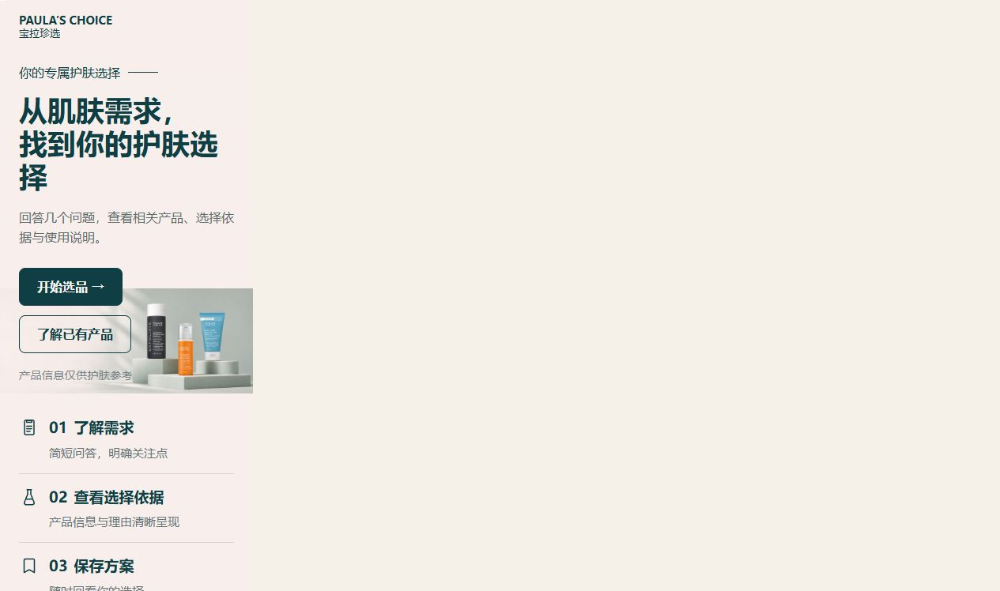
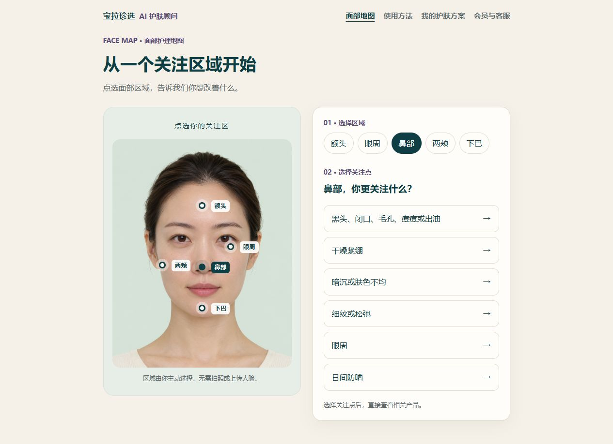
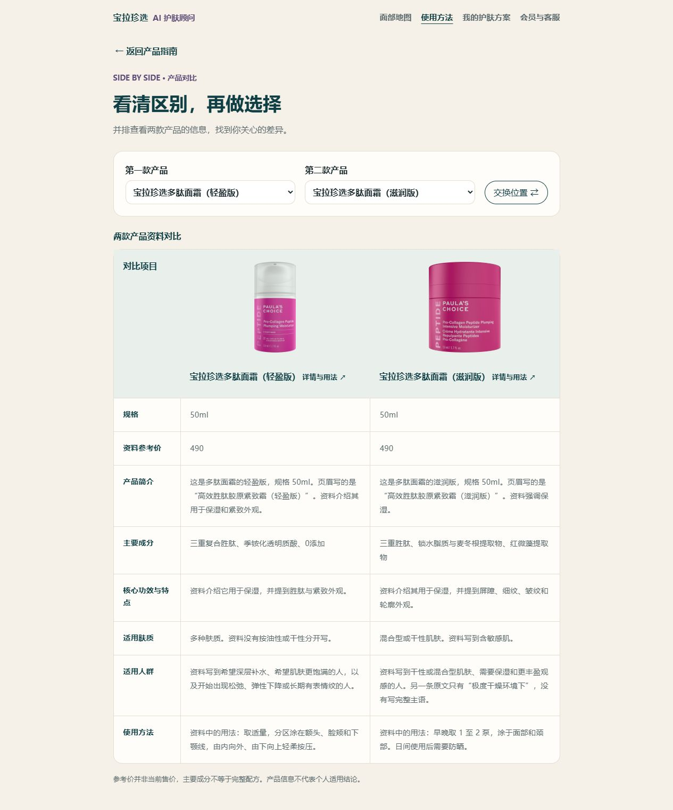

# AI Skincare Advisor · 护肤选购与使用顾问原型

A research-informed skincare advisor prototype connecting user research, transparent recommendation rules and a working React application.

基于用户研究，将选品、使用疑问和后续跟进需求转化为可交互原型。以宝拉珍选产品资料为案例，展示从研究证据到产品设计、规则实现和验证的过程。

> 本项目是团队项目背景下整理的作品集快照，与宝拉珍选官方无关联。当前演示使用规则与本地资料匹配，未接入大模型服务；“AI 顾问”是项目概念定位。原型不提供皮肤诊断或医疗建议。

## 项目体验

- [在线演示](https://baola-advisor.pages.dev/)（独立部署，可能与本仓库快照存在版本差异）
- [研究与产品决策](docs/research-and-decisions.md)
- [实现与验证](docs/implementation.md)
- [项目范围与贡献说明](docs/scope-and-contributions.md)
- [数据与素材说明](docs/data-and-assets.md)



## 要解决的问题

用户的问题不仅发生在购买之前，也发生在开始使用之后：如何识别具体产品、理解使用说明、判断资料是否足够，以及出现不适时下一步该做什么。原型将“帮我选”和“已有产品，了解用法”分开，并通过可追溯规则限制推荐范围。

## 已实现的体验

- 选品与使用问答：结合当前不适、肤质、目标、成分经验、已有产品和预算筛选。
- 面部区域入口：点击示意图进入相关产品结果，不要求上传面部照片。
- 产品浏览、详情与对比，以及保留选品状态的返回流程。
- 保存与模拟会员、跟进体验；相关状态存储在浏览器本地。
- 信息不足、不适和候选不明确等分支，避免强行给出产品。

| 面部区域入口 | 产品对比 |
|---|---|
|  |  |

## 研究基础与边界

项目材料包含问卷、访谈及社交平台讨论分析。此版本公开汇总方法与设计转化，不发布原始答卷、访谈或评论明细。

抖音评论文件的本地结构复核结果：1,300 条记录、8 个视频、5 个采集关键词；共有 1,120 种不同文本，按“同视频＋完全相同文本”合并得到 1,121 个文本单元。这些不是独立用户数。定向采样、来源集中和重复文本限制了外推；关键词检索结果不能视为人工确认后的需求频数。

## 本地运行

需要支持 `--experimental-strip-types` 的 Node.js 22.6+（建议使用受支持的 Node.js 22 或更高版本）与 npm。

```bash
npm ci
npm run dev
```

```bash
npm test
npm run lint
npm run build
npm run preview
```

`build` 与 `test` 会先从 `data/products.json` 生成前端目录 `data/products.public.json`。部署时需要支持 BrowserRouter 的 SPA 回退；构建输出为 `dist/`。

## 技术与目录

React、TypeScript、React Router、Vite；Node.js 内置测试工具。

```text
src/          页面、问答状态、筛选规则、保存与会员模拟
data/         产品资料、前端目录与图片来源记录
scripts/      产品目录导出
tests/        推荐规则、存储、展示、会员与跟进测试
public/       演示素材
docs/         研究方法、实现边界与项目说明
```

## 当前限制

这是可交互原型，未证明实际转化率、收入提升或护肤效果。产品价格为资料参考价，并非当前售价；产品资料提取与字段匹配不等于完成官方事实核验。没有真实会员账户、支付、后台消息发送或线上用户实验。

品牌名称、包装与其他第三方素材的权利归各自权利人。仓库未授予这些素材的再使用许可，也未为整个项目添加开源许可证。个人与团队贡献边界见贡献说明。
